<div align="center">

# tool-skills

*Skills para Claude Code que resuelven tareas concretas: de documentar un repo a sincronizar subtítulos.*

[](LICENSE)

[Skills](#skills) • [Instalación](#instalación) • [Uso](#uso) • [Cómo funciona](#cómo-funciona)

</div>

Nueve skills en español, cada una con sus pasos y su criterio de terminado, para que Claude Code siga el mismo proceso en cada corrida. Son para quien usa Claude Code y quiere instalarlas todas o solo las que le sirvan.

## Skills

| Skill | Qué hace |
|---|---|
| `tool:doc-estudio` | Escribe un `.md` que enseña un tema desde lo básico hasta la profundidad, con código verificado, diagramas, quiz y fuentes. |
| `tool:el-gremio` | Somete una decisión a 5 asesores que la analizan por separado, se revisan a ciegas y cierran con el veredicto de un presidente. |
| `tool:mini-tuto` | Propone una actividad corta dentro de tu proyecto para entender una tecnología y te guía mientras haces los cambios. |
| `tool:pdf` | Convierte un archivo de texto en PDF: dos columnas justificado, una columna o cuadernillo para imprimir, con diagramas en grises o a color. |
| `tool:readme` | Escribe o reescribe el `README.md` de un proyecto a partir de relevar todo el repo. |
| `tool:review-comments` | Revisa los comentarios del código y señala cuáles sobran, cuáles mienten y dónde falta uno. |
| `tool:roadmap` | Investiga temas en distintas fuentes y escribe un roadmap de estudio aplicado a tu proyecto, con el enlace de cada fuente. |
| `tool:subtitulos` | Busca, descarga y sincroniza subtítulos para un video local, y verifica contra el audio que encajan. |
| `tool:use-cases` | Genera el documento de casos de uso de un proyecto (actores, historias de usuario y reglas de negocio) para alguien no técnico. |

## Instalación

Requiere [Claude Code](https://docs.anthropic.com/en/docs/claude-code) y Linux o macOS: los nombres de las carpetas llevan `:`, que Windows no admite.

```bash
git clone https://github.com/CiroMirkin/tool-skills.git
cd tool-skills
mkdir -p ~/.claude/skills
ln -s "$PWD"/tool:* ~/.claude/skills/
```

Los enlaces hacen que un `git pull` actualice las skills. Para instalar solo una, enlaza únicamente su carpeta. Las skills nuevas aparecen al abrir una sesión nueva.

Algunas skills necesitan algo más:

- **`tool:doc-estudio`**: Python 3 y `curl`, las skills `diagram-design` y `humanizer`, y las herramientas para compilar y correr el código del tema, como `arduino-cli` en firmware.
- **`tool:pdf`**: [uv](https://docs.astral.sh/uv/), que instala sus dependencias al correr. También usa `pdftoppm` para revisar el resultado.
- **`tool:subtitulos`**: Linux x86_64. La primera vez instala uv, ffsubsync y ffmpeg en `~/.cache/subtitulos`, sin sudo.

## Uso

Escribe el nombre de la skill en Claude Code, o pide la tarea con tus palabras y Claude la activa solo:

```text
/tool:readme
/tool:subtitulos busca subtítulos para este video
/tool:pdf pasa notas.txt a cuadernillo
/tool:mini-tuto cómo ajustar una grilla en este sitio
```

> [!NOTE]
> `tool:subtitulos` anota en `peliculas.txt`, dentro de su carpeta, los títulos ya buscados para no repetir el trabajo. Esa lista es local: git la ignora y la skill la crea la primera vez que hace falta.

## Cómo funciona



Claude Code carga las skills desde `~/.claude/skills` y ejecuta la que corresponde a tu pedido. Según la skill, consulta OpenSubtitles, investiga en la web, instala dependencias, y lee o escribe archivos de tu máquina.
