<div align="center">

# tool-skills

*Skills para Claude Code que resuelven tareas concretas: de documentar un repo a escribir un A3.*

[](LICENSE)

[Skills](#skills) • [Instalación](#instalación) • [Uso](#uso) • [Cómo funciona](#cómo-funciona)

</div>

Dieciséis skills en español, repartidas en tres carpetas (`learn`, `code` y `tools`; el prefijo de cada skill es el nombre de su carpeta), cada una con sus pasos y su criterio de terminado, para que Claude Code siga el mismo proceso en cada corrida. Son para quien usa Claude Code y quiere instalarlas todas o solo las que le sirvan.

## Skills

| Skill | Qué hace |
|---|---|
| `tools:a3` | **(En etapa de prueba)** Escribe un A3 al estilo Toyota: el problema, su causa, la contramedida, el plan y el seguimiento en una página, como alternativa corta a un spec. |
| `code:test-audit` | **(En etapa de prueba)** Auditoría profunda y manual de tests con mutantes (a mano y con mutator y crapper, previa aprobación) y refactores en una copia, y señala cuáles no protegen nada, cuáles impiden refactorizar y qué reglas de negocio quedaron sin test. |
| `code:test-review` | Revisión rápida y automática al planear y al escribir tests: asegura TDD, FIRST y cobertura de las reglas de negocio, y corrige los que no protegen nada, están atados al cómo, abusan de mocks, son complejos o tienen nombre técnico. |
| `code:dev-work` | Principios para escribir o cambiar código: siempre en una rama propia, primero que funcione, después que esté bien, con evidencia de que anda. Basada en las reglas de Robert C. Martin (Uncle Bob) y Lauren Tan. |
| `tools:diagrama-hardware` | Dibuja esquemáticos y diagramas de conexionado de circuitos como SVG con schemdraw. Basada en `schemdraw-circuit-generator` de takazudo/claude-resources. |
| `learn:doc-estudio` | Escribe dos `.md` complementarios que enseñan un tema desde cero (fundamentos y avanzado), con repo de pruebas, tres tareas con tests por doc, diagramas, quiz y fuentes. |
| `tools:el-gremio` | Somete una decisión a 5 asesores que la analizan por separado, se revisan a ciegas y cierran con el veredicto de un presidente. |
| `tools:informe-cambios` | **(En revisión)** Escribe un informe de cambios para enviar a un cliente: un `.md`, un PDF general y un PDF por etapa, cada cambio con su porqué, cómo se detectó y qué cambia. |
| `learn:learn` | **(En etapa de prueba)** Genera un `.html` que te enseña desde cero una parte de tu código o un concepto (por ejemplo, transacciones): diagramas, código real de tu proyecto y de uno ficticio, ejercicios para encontrar errores y una tarea con ayudas. Lo guarda para consultarlo después. |
| `tools:policy` | **(En etapa de prueba)** Prepara los documentos legales para lanzar un repositorio: política de privacidad y de seguridad, `SECURITY.md`, términos, cookies, proveedores, procedimientos y un checklist de trámites, todo a partir de lo que el código hace de verdad. |
| `tools:readme` | Escribe o reescribe el `README.md` de un proyecto a partir de relevar todo el repo. |
| `learn:referencia` | Suma un repo o un sitio (`/learn:referencia <url>`), o la ruta de tu carpeta de libros y apuntes (`--docs <ruta>`), a la base de referencias de desarrollo que consultan `learn:roadmap`, `learn:learn` y `learn:doc-estudio`. |
| `code:cuestioname` | **(En etapa de prueba)** Sortea una parte del sistema de tu proyecto y te toma un cuestionario HTML de 4 preguntas sobre cómo funciona y cómo está implementada; cada error se explica y se vuelve a preguntar con otros datos. |
| `code:review-comments` | Revisa los comentarios del código y señala cuáles sobran, cuáles mienten y dónde falta uno. |
| `learn:roadmap` | Investiga temas en distintas fuentes y escribe un roadmap de estudio aplicado a tu proyecto, o un vistazo general del área si no tienes uno, con el enlace de cada fuente. |
| `tools:use-cases` | Genera el documento de casos de uso de un proyecto (actores, historias de usuario y reglas de negocio) para alguien no técnico. |

## Instalación

Requiere [Claude Code](https://docs.anthropic.com/en/docs/claude-code) y Linux o macOS: los nombres de las carpetas llevan `:`, que Windows no admite.

```bash
git clone https://github.com/CiroMirkin/tool-skills.git
cd tool-skills
mkdir -p ~/.claude/skills
ln -s "$PWD"/{learn,code,tools}/*:* ~/.claude/skills/
```

Los enlaces hacen que un `git pull` actualice las skills. Para instalar solo una, enlaza únicamente su carpeta. Las skills nuevas aparecen al abrir una sesión nueva.

Algunas skills necesitan algo más:

- **`tools:diagrama-hardware`**: Python 3 con `schemdraw` y `matplotlib`. Con [uv](https://docs.astral.sh/uv/) alcanza con `uv run --no-project --with schemdraw --with matplotlib python script.py`. Para simular el circuito usa `ngspice` (`sudo apt install ngspice`); si falta, la skill pregunta antes de instalarlo.
- **`code:dev-work`**: usa `code:test-review`, así que conviene instalar las dos, y [dryer](https://github.com/unclebob/dryer) para buscar duplicación (pide aprobación antes de instalarlo).
- **`learn:doc-estudio`**: Python 3 y `curl`, las skills `diagram-design` y `humanizer`, y las herramientas para compilar y correr el código del tema, como `arduino-cli` en firmware.
- **`learn:learn`**: Python 3, [uv](https://docs.astral.sh/uv/) (instala `pygments` al correr) y internet para investigar. Usa las skills `diagram-design` y `humanizer`, y las herramientas para ejecutar el código del tema. Las lecciones se guardan en `learn:learn/memoria/`, que git ignora.
- **`tools:informe-cambios`**: Node.js con `npm` (instala sus dependencias la primera vez), Python 3 e internet para bajar las fuentes. Usa la skill `humanizer` y `pdftoppm` para revisar los PDF.
- **`learn:referencias-base`**: no es una skill, es la carpeta con `referencias.md` que leen `learn:roadmap`, `learn:learn`, `learn:doc-estudio` y `learn:referencia`. Si instalas esas por separado, enlaza también esta carpeta. Guarda en `documentos-locales.md`, que git ignora, la ruta de tu carpeta de documentos personales; las skills eligen ahí solo los que aportan algo y leen únicamente las partes necesarias (un PDF por páginas, salvo que pidas leerlo completo).

## Uso

Escribe el nombre de la skill en Claude Code, o pide la tarea con tus palabras y Claude la activa solo:

```text
/tools:readme
/learn:roadmap armá un roadmap de estudio sobre este tema
/tools:informe-cambios arma el informe para el cliente
```

## Cómo funciona



Claude Code carga las skills desde `~/.claude/skills` y ejecuta la que corresponde a tu pedido. Según la skill, investiga en la web, instala dependencias, y lee o escribe archivos de tu máquina.
