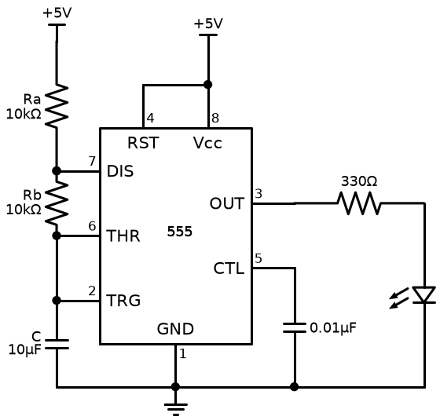
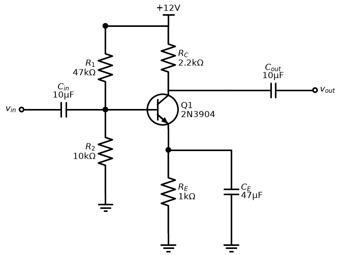
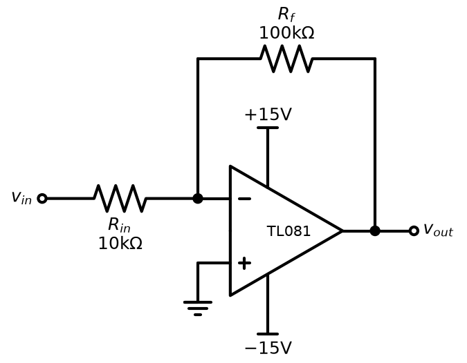
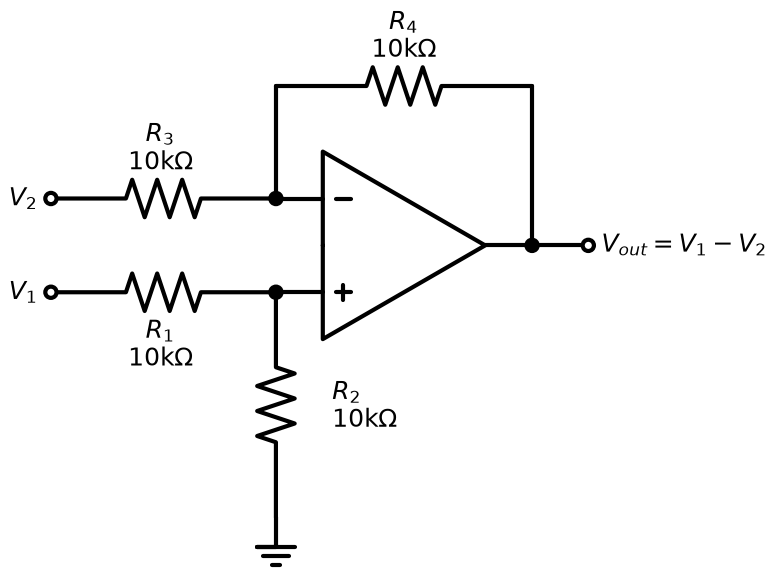
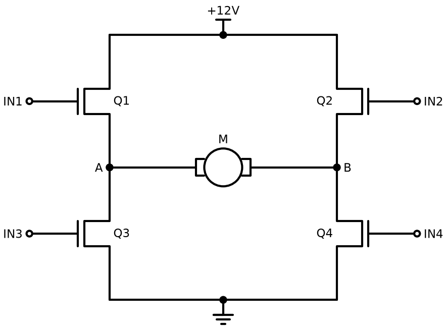
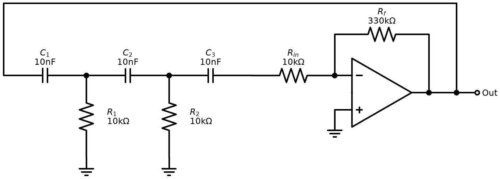
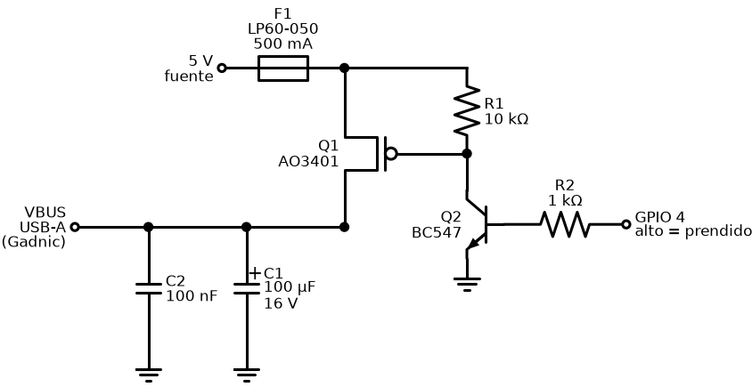
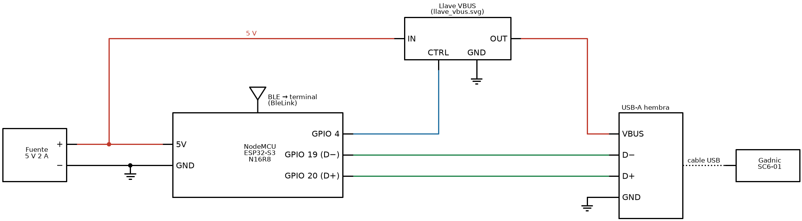

# tool:diagrama-hardware

Dibuja esquemáticos y diagramas de conexionado de circuitos como SVG (o PNG/PDF) con la librería de Python [schemdraw](https://schemdraw.readthedocs.io/). Claude escribe un script `.py` que describe el circuito y lo corre para obtener la imagen.

Es una copia de `schemdraw-circuit-generator`, de [takazudo/claude-resources](https://github.com/takazudo/claude-resources) (licencia MIT), con las correcciones que se listan en [Cambios respecto de la original](#cambios-respecto-de-la-original).

## Requisitos

- Python 3 con `schemdraw` y `matplotlib`. Con [uv](https://docs.astral.sh/uv/) no hace falta instalar nada:

  ```bash
  uv run --no-project --with schemdraw --with matplotlib python diagrama.py
  ```

## Ejemplos de salida

### Esquemáticos

| Temporizador 555 que hace parpadear un LED | Amplificador en emisor común |
|---|---|
|  |  |
| **Amplificador inversor** | **Amplificador diferencial** |
|  |  |
| **Puente H con cuatro MOSFET** | **Oscilador por desplazamiento de fase** |
|  |  |

### Hardware de un proyecto

Llave que corta la alimentación de un lector USB, con un P-MOSFET manejado por un NPN desde un GPIO:



Conexionado de una caja con fuente, ESP32-S3, la llave y un USB-A. Usa bloques `elm.Ic` con pines y cables de colores (rojo para 5 V, azul para control y verde para datos):



## Limitaciones y advertencias

- **No valida el circuito.** Dibuja lo que dice el script: si una conexión está mal, el diagrama sale mal sin ningún error. Hay que comparar cada conexión con la fuente (datasheet, documento de hardware).
- **Cada diagrama hay que mirarlo.** Que el script corra sin errores no significa que el dibujo esté bien. Hay que renderizar un PNG, mirarlo y corregir hasta que esté limpio. Los errores más comunes son:
  - componentes rotados;
  - rótulos pisados;
  - cables que pasan por encima de un componente;
  - nodos sueltos que parecen conectados.
- **La ubicación es manual.** schemdraw no acomoda los elementos ni rutea cables solo: cada posición sale de las coordenadas o anclas del script. En circuitos grandes el script se alarga y los cruces de cables son difíciles de evitar.
- **Fondo transparente en modo oscuro.** `SKILL.md` recomienda líneas negras sobre fondo transparente. En un visor con tema oscuro (por ejemplo GitHub) el diagrama casi no se ve. Las imágenes de este README son PNG con fondo blanco por eso.
- **No sirve para diagramas de bloques genéricos.** Para flujos, arquitectura o diagramas de software conviene Mermaid o `diagram-design`. Del otro lado, Mermaid no tiene símbolos de componentes, así que no reemplaza a esta skill para esquemáticos.
- **Partes heredadas de la original:**
  - `SKILL.md` está en inglés y es largo (unas 800 líneas).
  - Menciona Context7 y capturas con un navegador headless, que pueden no estar disponibles.
  - El autor la marcó como *deprecated* y la sacó de su repo; esta copia sale del commit anterior a ese.

## Cambios respecto de la original

- `name:` del frontmatter cambiado a `tool:diagrama-hardware`.
- `SKILL.md`, tres arreglos de redacción para que el agente siga siempre el mismo camino:
  - El flujo incremental y el de todo de una vez estaban completos uno al lado del otro, y el incremental aparecía dos veces. Ahora el inicio tiene solo los pasos comunes y una regla para elegir: todo de una vez solo con menos de 5 componentes y si el usuario lo pide. Ese flujo pasó a `references/all-at-once.md`.
  - Se sacaron los ejemplos de código marcados como incorrectos (❌ WRONG) y la anécdota del `loc='left'`. Queda solo la forma correcta, porque mostrarle al agente el código malo lo vuelve más probable.
  - Se resolvió una contradicción: decía que no confiara en su propia revisión visual y después le pedía hacerla. Ahora el agente revisa cada captura con el checklist y la aprobación del usuario es la que cierra el diagrama.
- `references/examples.md`: el ejemplo 2 (inversor) se corrigió. Las líneas de alimentación son más cortas, el lazo de R_f pasa por encima de +15V y TL081 está adentro del operacional.
- `references/examples.md`: el ejemplo 3 (diferencial) se corrigió. El rótulo de R1 pasó abajo para no tocar el de R3, el de R2 está a la derecha y hay puntos de unión en las dos entradas.
- `references/examples.md`: el ejemplo 4 (emisor común) se reescribió. Ahora el divisor de base está a la izquierda, R1 y RC se unen en una línea de +12V y CE está en paralelo con RE.
- `references/examples.md`: el ejemplo 5 (puente H) se reescribió. En schemdraw 0.23 cortaba con un error (`down(d.unit)` en un `NFet`) y quedaba medio dibujado. Ahora las dos patas, los rieles de +12V y masa y el motor entre A y B se ubican con coordenadas explícitas.
- `references/examples.md`: el ejemplo 6 (oscilador por desplazamiento de fase) se rearmó. R_f y R_in quedaban en serie con la red y el último capacitor no volvía a la entrada; además la ganancia era 10 y hacen falta 29. Ahora es la red clásica de tres C en serie con R a masa, R_in hace de tercera R y R_f es 330kΩ (ganancia 33).
- `references/troubleshooting.md`: tres problemas nuevos, encontrados al dibujar hardware real:
  - Transistores y FET que salen rotados porque heredan la dirección del elemento anterior. Se arregla con `.right()` antes de `.anchor(...)`.
  - En `elm.Ic` los pines de los lados izquierdo y derecho se listan de abajo hacia arriba, y no hay anclas `E`/`N`.
  - Para pasar al otro lado el rótulo de una resistencia vertical, se usa `loc='bot'`.
